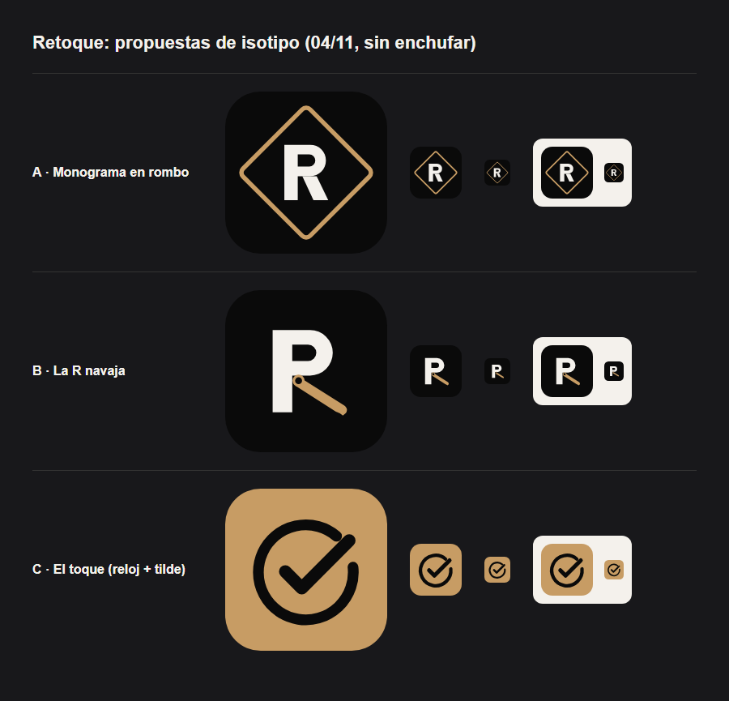

# Retoque: propuestas de isotipo (04/11/2026)

> **Para que elija Nico. Ninguna está enchufada:** hoy el producto usa su logo tipográfico
> (`src/components/ui/Logo.tsx`, que dibuja "RETOQUE") y el ícono con la inicial (`src/lib/icono.tsx`).

| | Propuesta | Qué dice | A favor | En contra |
|---|---|---|---|---|
| A | [Monograma en rombo](./a-monograma-rombo.svg) | La R dentro del rombo del logo (el del filete de abajo) | Sigue al logo actual: todo queda de la misma familia | Es la más "segura": se parece a muchos monogramas |
| B | [La R navaja](./b-navaja.svg) | La pierna de la R es la hoja de una navaja | La más "barbería": se entiende el rubro de un vistazo | Ata la marca a las barberías si después se suman uñas o estética |
| C | [El toque](./c-el-toque.svg) | Un reloj abierto que cierra un tilde: el turno, reservado | La más "app": se lee bien en 24 px y sirve para cualquier rubro | Es genérica: un tilde en un círculo lo usan muchas apps |

Están dibujadas a mano en SVG (sin tipografías instaladas), en los colores del producto: negro
`#0a0a0a`, madera `#c79c64` y papel `#f4f1ec`.

**Si elegís una:** se enchufa en `src/lib/icono.tsx` (el ícono de la pestaña y del celu) y, si
querés, al lado del nombre en `Logo.tsx`. Es un cambio chico, en otra tanda.
